# Installing LakoOS

Tested in a virtual machine: UEFI (OVMF), q35, 4 GB of memory, an NVMe disk, `LakoOS-amd64-setup.iso`.
The same steps apply to arm64 and to BIOS machines.

## 1. Start from the setup image

Attach `LakoOS-amd64-setup.iso` and boot. Pick the language and keyboard layout.

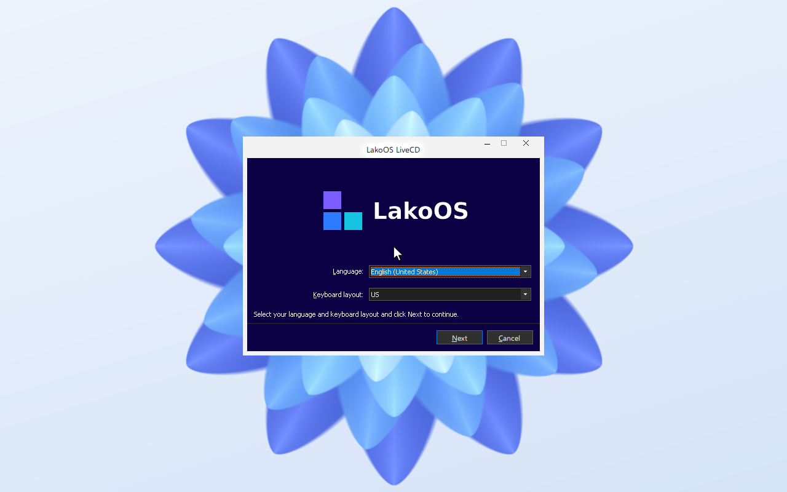

## 2. Run the installer

Choose **Install LakoOS** (or **Run LakoOS Live CD** to try it without installing).

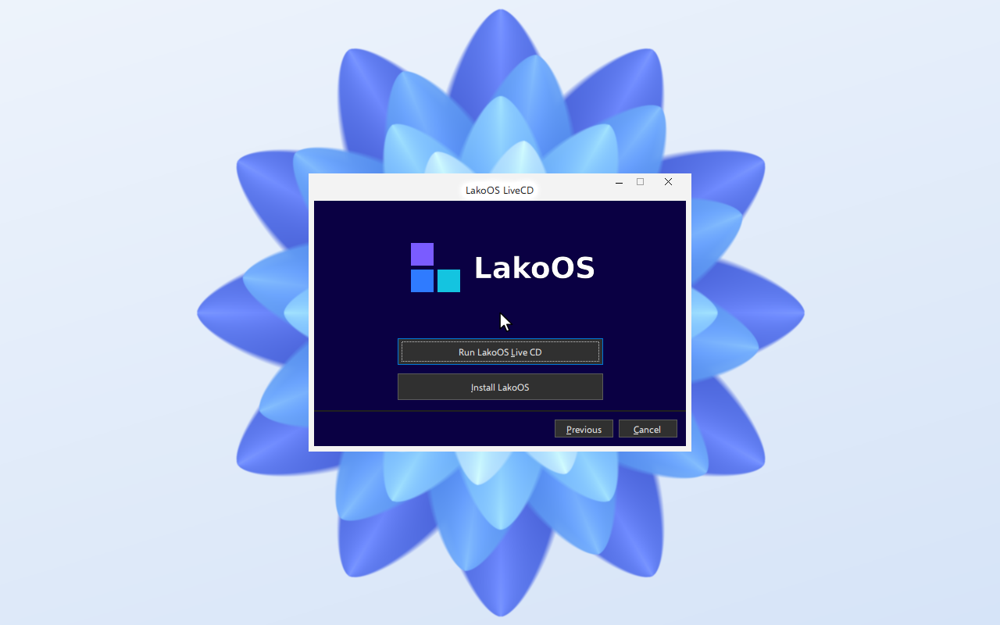

The wizard opens. Read the notice and continue.

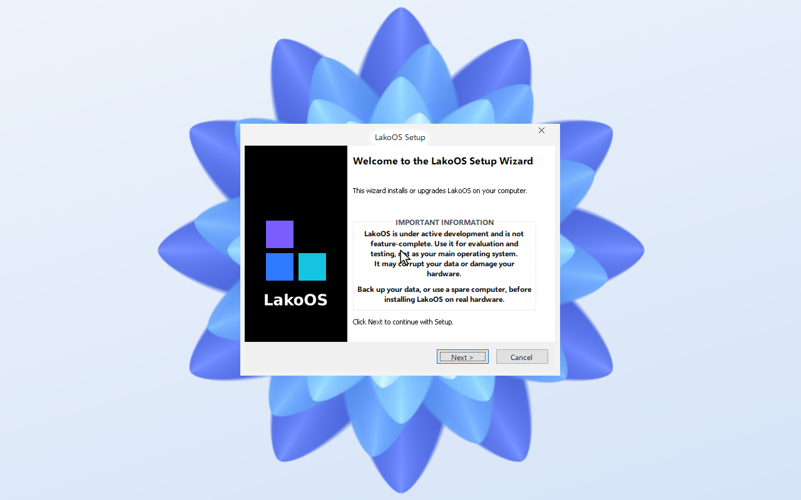

## 3. Installation type

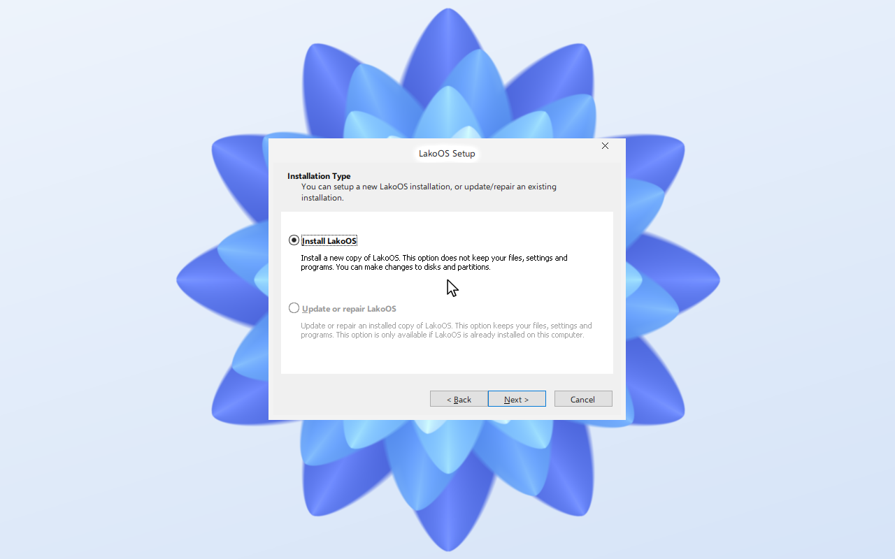

## 4. Choose the disk

Select the disk or free space and tick the confirmation that the disk will be erased.

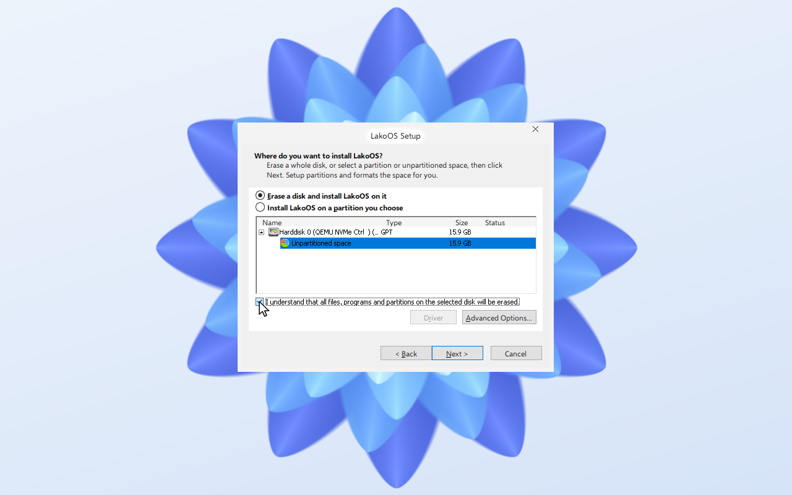

## 5. Name your PC and create an account

If you leave the password empty, LakoOS signs in automatically.

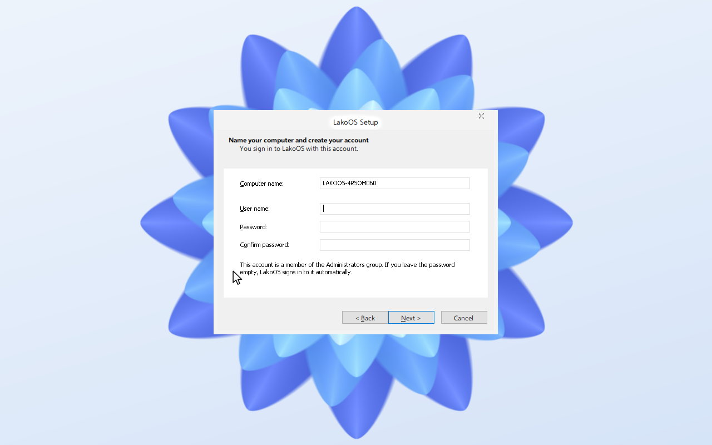

## 6. Time zone

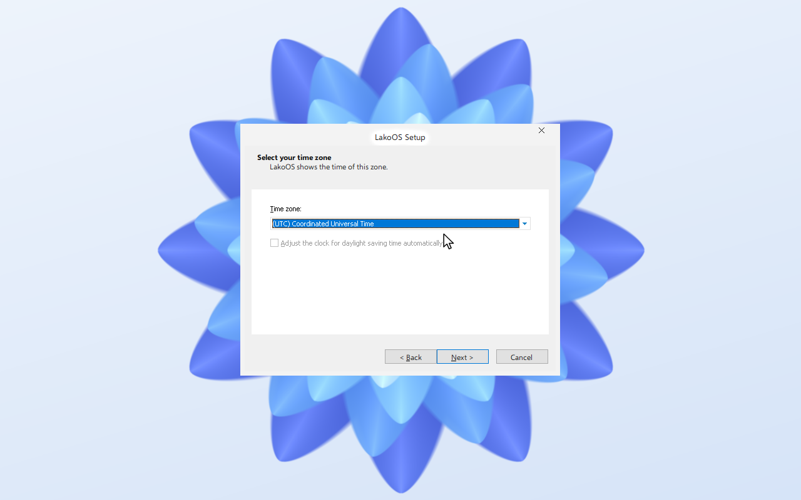

## 7. Review and install

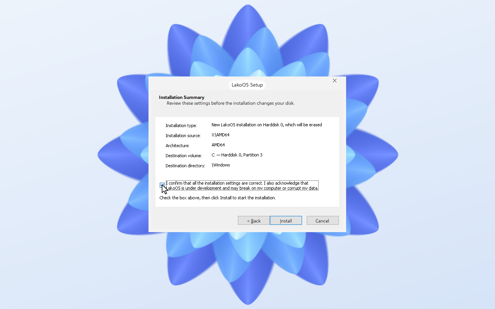

## 8. Wait for the copy to finish

The list shows which stage the installer is in. The VM restarts when it is done.

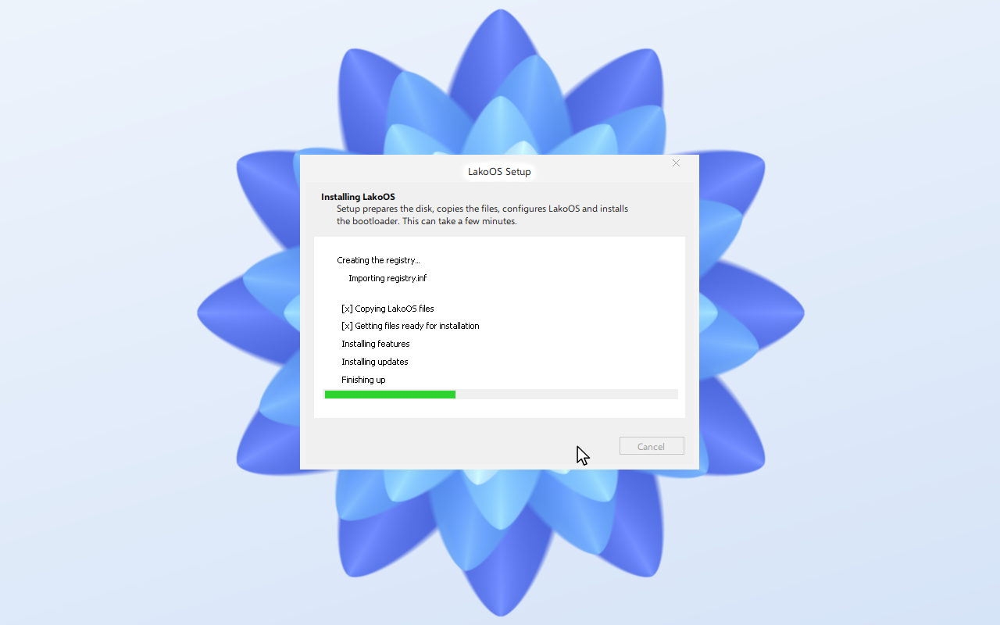

## 9. First start

Remove the setup image so the machine boots from the disk. You arrive at the desktop.

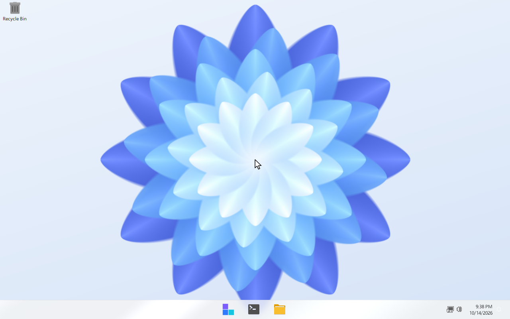

| Start | File Explorer |
|---|---|
| 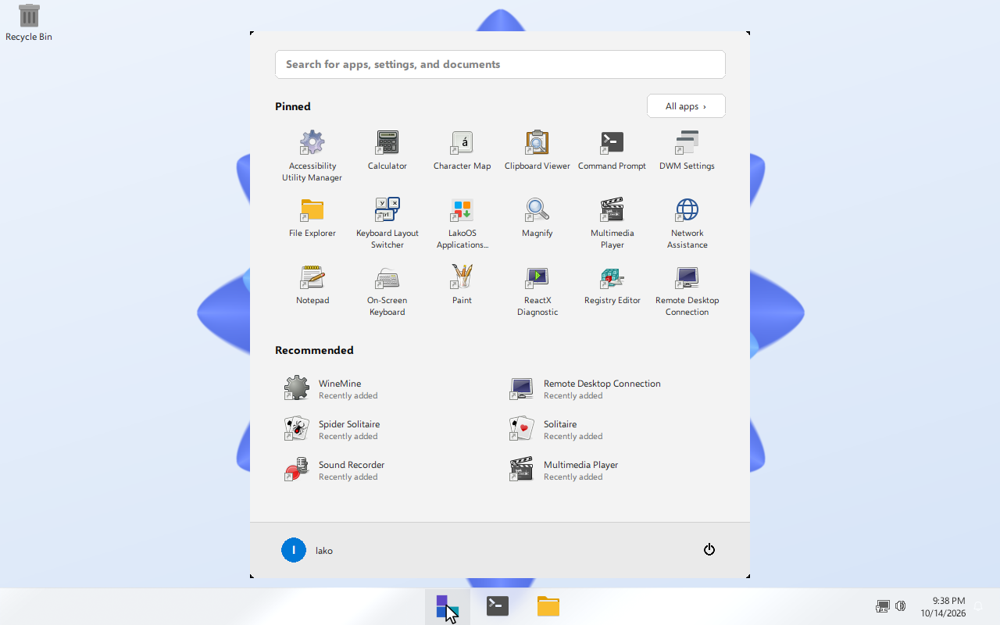 | 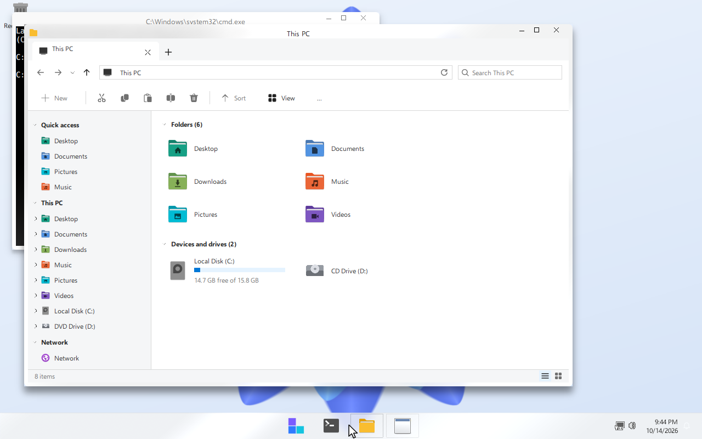 |

| Control Panel | System properties |
|---|---|
| 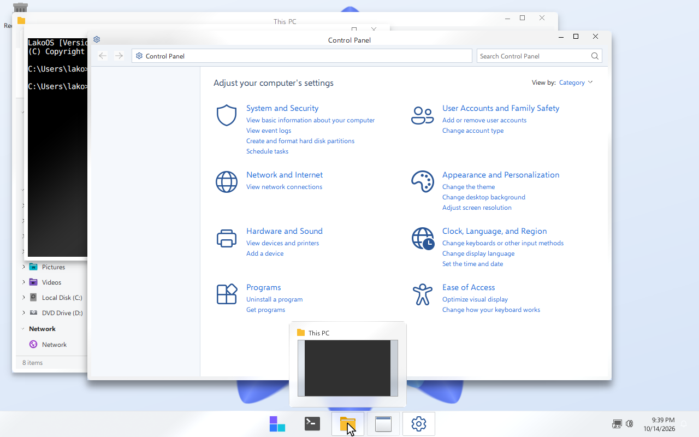 | 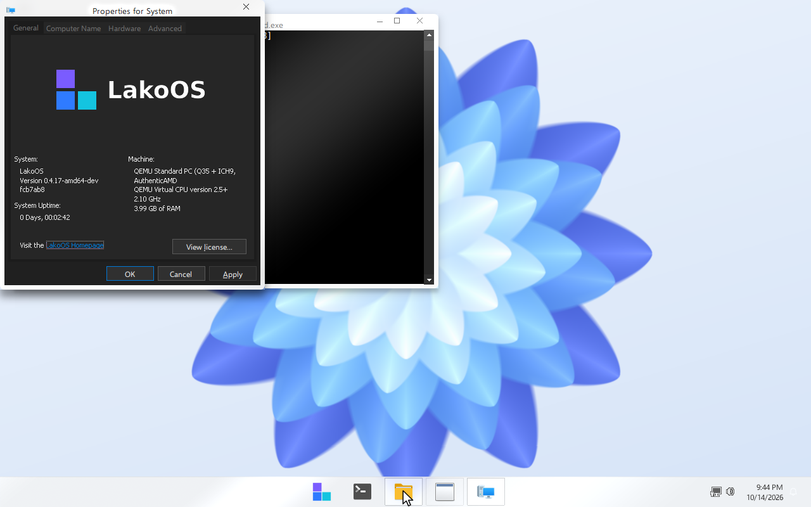 |
